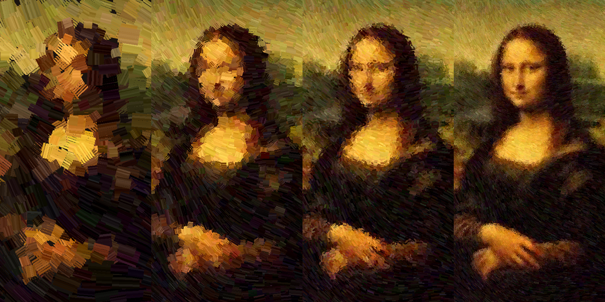

<div align="center">

# Coded Mona Lisa

**A masterpiece repainted by code: about 30,000 brush strokes, from rough shapes to fine detail.**


*the painting building itself, stroke by stroke*



</div>

---

## What it does

The program starts with a dark canvas and paints the Mona Lisa the way an old master would, in layers. Large, rough strokes block in the light and dark shapes first. Each layer then uses a smaller brush to refine the picture, until her face, hands and the hazy landscape appear.

- About **30,000 strokes** in six layers, with brush sizes from 34 pixels down to under 3
- Every stroke is made of several **bristle lines**, so the paint has texture
- The finest strokes are focused on the **face and hands**, where the eye looks first

## How it works

This is a small data science project in disguise.

1. **Color:** each stroke takes its color from a blurred copy of the reference image. The blur gets lighter on every layer, so early strokes capture broad areas and later ones capture detail.
2. **Direction:** the program computes the **image gradient** and turns every stroke to follow the edges, not cross them. In flat areas, where there is no clear edge, it blends in a smooth direction field so the strokes still look natural.
3. **Length:** strokes shrink near strong edges, so they stop at the outline of a face instead of smearing past it.
4. **Attention:** a **saliency map** combines edge strength with hand-placed weights for the face and hands. Fine layers only paint where the map is high, which puts the detail where it matters.
5. **Time:** each layer has its own window, and strokes appear in order, so you can watch the portrait emerge.

## Run it

You need Python 3 and two packages:

```
pip install pygame-ce numpy
python monalisa.py
```

Keep `mona_lisa.png` in the same folder as `monalisa.py`. Press `Esc` to close the window.

## Paint your own

The program works on any picture. Replace `mona_lisa.png` with a portrait of your own, keeping the same file name, and it will paint that instead. Portrait photos with a clear subject work best, and a larger image gives sharper detail.

You can also change the look in `monalisa.py`:

```python
radii = [34, 20, 12, 7, 4.0, 2.6]    # brush size for each layer
passes = [2, 2, 2, 1, 1, 1]          # how many times each layer covers the canvas
t0s = [0.0, 2.5, 6.0, 10.5, 16.0, 22.0]   # when each layer starts, in seconds
t1s = [2.5, 6.0, 10.5, 16.0, 22.0, 28.0]  # when each layer ends
```

## Credits

The Mona Lisa was painted by Leonardo da Vinci around 1503 to 1519 and is in the public domain. This project is an artistic experiment in how code can paint.

## About

Built by a young woman in tech and a poet, exploring where code and art meet.

**TikTok:** [@_theauthoress_](https://www.tiktok.com/@_theauthoress_)
